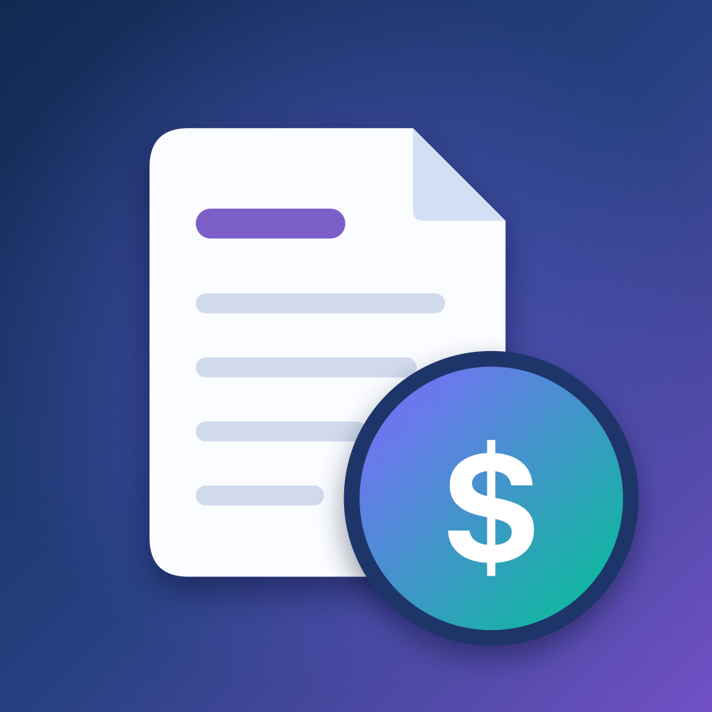

# 📱 Freelance Invoice & Payment Tracker

A **premium iOS application** built with **Swift & SwiftUI** for freelancers to manage invoices, track payments, and monitor income — fully offline with biometric security.

<p align="center">
  
</p>

## ✨ Features

| Feature | Description |
|---------|-------------|
| 🔐 **Biometric Auth** | Face ID / Touch ID via LocalAuthentication framework |
| 📊 **Dashboard** | Live stats — total invoices, pending amount, paid & overdue counts |
| 🧾 **Invoice CRUD** | Create, view, edit, and delete invoices with full validation |
| 🔍 **Search & Filter** | Search by title/client/number; filter by category and payment status |
| 💰 **Payment Tracking** | Paid, Pending, Overdue statuses with automatic overdue detection |
| 💾 **Offline Storage** | JSON-based local persistence — works 100% offline |
| ⚙️ **Settings** | Currency display, biometric preference, app info |

## 🏗️ Architecture

```
MVVM (Model-View-ViewModel) — strict separation of concerns
```

```
FreelanceInvoiceTracker/
├── App/                    # App entry point
├── Models/                 # Invoice, Client, InvoiceCategory
├── ViewModels/             # AuthenticationVM, DashboardVM, InvoiceListVM, etc.
├── Views/
│   ├── Authentication/     # BiometricAuthView, LoginView
│   ├── Dashboard/          # DashboardView
│   ├── Invoice/            # List, Card, Add, Edit, Detail views
│   ├── Components/         # Reusable UI components
│   └── Settings/           # SettingsView
├── Services/               # BiometricAuthService, InvoiceStorageService
├── Utilities/              # DateFormatterHelper, CurrencyFormatter, AppConstants
└── Resources/              # Assets, App Icon
```

## 🛠️ Tech Stack

- **Language:** Swift 5.9+
- **UI Framework:** SwiftUI
- **Architecture:** MVVM
- **Storage:** JSON (local file persistence)
- **Auth:** Apple LocalAuthentication (Face ID / Touch ID)
- **Security:** Salted SHA-256 password hashing via CryptoKit
- **Navigation:** NavigationStack + TabView
- **Minimum iOS:** 17.0
- **Third-party libraries:** None

## 🎨 Design

- **Primary:** Dark Navy Blue
- **Secondary:** Purple
- **Accent:** Green
- **Style:** Rounded cards, SF Symbols, modern finance dashboard aesthetic

## 🚀 Getting Started

### Prerequisites
- Xcode 15 or later
- iOS 17+ simulator or device

### Run the App

```bash
git clone https://github.com/YOUR_USERNAME/FreelanceInvoiceTracker.git
cd FreelanceInvoiceTracker
open FreelanceInvoiceTracker.xcodeproj
```

Press **⌘ + R** in Xcode to build and run.

### Demo Login
On first launch, set up your local demo credentials (stored as SHA-256 hash — never plain text):
- **Username:** any (min 3 characters)  
- **Passcode:** any (min 6 characters)

> ⚠️ This is **local-only authentication** — no server or account is used.

## 🧪 Tests

```bash
xcodebuild test -scheme FreelanceInvoiceTracker -destination "platform=iOS Simulator,name=iPhone 16 Pro"
```

**7 unit tests** covering:
- Payment status rules
- Persistence & reload
- Edit preserves invoice ID
- Duplicate invoice number rejection
- Validation rules
- Combined search + filter
- Dashboard stats auto-update

## 📸 Screenshots

> App running on iPhone Simulator — Login → Dashboard → Invoice List → Invoice Detail

## 📄 License

MIT License — see [LICENSE](LICENSE) for details.
